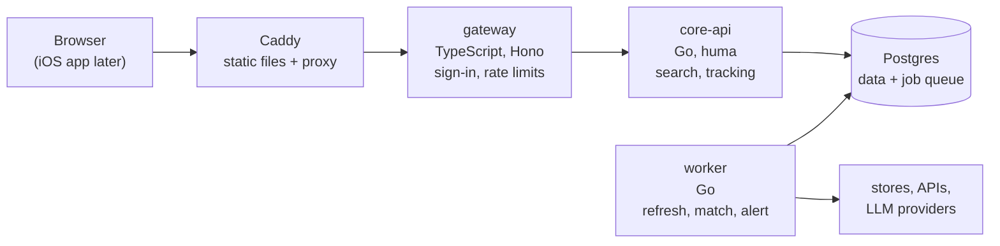

# Dipwatch

Name a product, see who sells it cheapest, and get alerted when the price dips.

Dipwatch collects offers for a product (for example "RTX 5090") from stores in China and overseas, filters out accessories and unrelated listings with an LLM, ranks what is left by price, and tracks the product for you. When a tracked product drops in price or comes back in stock, it sends you a Feishu message (email once SMTP is set).

It is also a learning project: a Go backend, an AI browsing agent, and a full CI/CD pipeline, built in one week with spec-driven development. See [docs/](docs/) for the spec, design and daily tasks.

> **Status: Day 7 of 7.** Search, sign-in, tracking and Feishu alerts are live. Live stores: Kakaku.com (Japan, HTML) and SMZDM (China, AI agent). JD is built on its affiliate API and goes live with an app key. Progress and results are in [docs/tasks.md](docs/tasks.md).

## Features

| Feature                                                                                                                        | Status                                                  |
| ------------------------------------------------------------------------------------------------------------------------------ | ------------------------------------------------------- |
| Search one store at a time, ranked by price in CNY, results streamed as stores finish                                          | Done (Days 4 to 6)                                      |
| Stores: Kakaku.com (HTML), SMZDM (AI agent), JD (affiliate API, needs an app key)                                              | Done; Amazon blocks the server, see Day 5 notes         |
| AI browsing agent with a harness: budgets, guards, run recording with cost and trace                                           | Done (Day 3)                                            |
| Agent offline eval set: precision, recall and cost per store; prompt-injection case                                            | Done (Day 4), log in [docs/harness.md](docs/harness.md) |
| LLM matching: drop accessories, English titles, condition                                                                      | Done (Day 4)                                            |
| Query gate: input checks and one product per spelling                                                                          | Done (Day 4)                                            |
| Sign in with GitHub (email magic link built, live once SMTP is set)                                                            | Done (Day 5)                                            |
| Admin: per-source metrics, run list and trace, live agent log                                                                  | Done (Days 5 and 6)                                     |
| Track products with notes and alert rules, price history chart, Feishu alerts                                                  | Done (Day 6)                                            |
| Budget limits you change on the admin page: stores per search, tracked products, quotas, daily LLM budget with a spend breaker | Done (Days 6 and 7)                                     |
| Deploy on merge to `main`, automatic rollback, daily database backups                                                          | Done (Days 2 and 7)                                     |
| iOS app with push notifications                                                                                                | After week 1                                            |

## How it works



- **Caddy** serves the built web app and forwards `/api` to the gateway. It is the only service reachable from outside.
- **gateway** handles sign-in and sessions (Better Auth), then calls core with the member's id, role and a shared internal token. It strips any identity headers a client sends.
- **core-api** owns all product data and generates the OpenAPI contract that every client uses.
- **worker** runs background jobs: refreshing offers, matching listings with an LLM, checking alert rules and sending notifications.
- **Sources** are tried cheapest first: official API, a store's MCP server, a plain HTML parser, and finally an AI agent driving a real browser. Scheduled price checks reuse what the agent learned, so they cost no LLM tokens. Details in [docs/design.md](docs/design.md).

## Repository layout

```
contracts/openapi.yaml   API contract, generated from the Go code (do not edit)
core/                    Go module: core API and worker
  cmd/core-api/          HTTP server; subcommands serve, migrate, openapi
  cmd/worker/            background job runner
  internal/config/       environment variables
  internal/db/           Postgres pool and embedded SQL migrations
  internal/http/         API operations (source of the contract)
  internal/agent/        browsing agent and its harness; eval/ holds the offline eval
  internal/guard/        input checks, intent gate, quotas
  internal/search/       search, ranking, result streams
  internal/matcher/      LLM listing matcher
  internal/tracking/     tracked products and alert settings
  internal/alerts/       alert rules; internal/notify/ sends Feishu and email
  internal/limits/       budget limits; internal/spend/ is the daily spend breaker
  internal/jobs/         River jobs: refreshes, alerts, schedule, FX
  internal/live/         live agent log for the admin page
  internal/money/        prices as integer minor units
  internal/sources/      source adapters and the strategy registry
  internal/store/        typed queries generated by sqlc
gateway/                 TypeScript gateway (Hono)
web/                     React web app (Vite, TanStack Query, Zustand, Tailwind)
  src/pages/             one folder per page, split into Model / View / Component modules
  src/services/          the only code that calls the API; schema.d.ts is generated
deploy/                  docker compose file, Caddyfile, deploy and backup scripts, .env.example
tools/spike/             one-off feasibility programs
docs/                    constitution, spec, design, daily tasks, spike results
.github/workflows/       CI
```

## Tech stack

| Layer   | Choice                                                                                 |
| ------- | -------------------------------------------------------------------------------------- |
| Web     | React 19, Vite, TanStack Query, Tailwind CSS, `openapi-fetch`                          |
| Gateway | TypeScript, Node 24, Hono, Better Auth                                                 |
| Core    | Go 1.27, huma + chi, pgx, goose, sqlc, River, goquery                                  |
| Agent   | Go MCP client driving Playwright MCP, any OpenAI-compatible LLM (DeepSeek, Qwen, Kimi) |
| Data    | Postgres 16                                                                            |
| Edge    | Caddy                                                                                  |
| CI/CD   | GitHub Actions, images in Aliyun Container Registry, deploy over SSH                   |

## Run it locally

Requirements: Go 1.27, Node 24, pnpm, Docker, and `make`.

```bash
git clone https://github.com/FinA1ee/dipwatch.git
cd dipwatch
pnpm install
make dev
```

`make dev` creates `deploy/.env` with random secrets on first run, builds the images and starts the stack. Open http://localhost:18080 and search for a product; Kakaku.com works without any key.

Optional settings in `deploy/.env` (see `.env.example` for each):

- `LLM_API_KEY` (any OpenAI-compatible API; DeepSeek by default) turns on the query check, the matcher and the browsing agent.
- Sign-in: locally, magic links are printed to the gateway's log (`make logs`), so any email works. Put that email in `ADMIN_EMAILS` to open `/admin`. GitHub sign-in needs `GITHUB_CLIENT_ID` and `GITHUB_CLIENT_SECRET`.
- Stores are switched on in the `app.sources` table; Kakaku.com is on by default.

Default host ports are 18080 (site) and 25432 (Postgres, localhost only), chosen to avoid clashing with other local services. Change `HTTP_PORT` and `PG_HOST_PORT` in `deploy/.env` if needed.

### Common commands

| Command                                        | What it does                                                                |
| ---------------------------------------------- | --------------------------------------------------------------------------- |
| `make dev`                                     | Build and start everything                                                  |
| `make down`                                    | Stop everything (data is kept)                                              |
| `make logs`                                    | Follow logs                                                                 |
| `make db`                                      | Start only Postgres, for running Go tests on the host                       |
| `make test`                                    | Go and TypeScript tests                                                     |
| `make lint`                                    | `go vet`, Biome, TypeScript type-check                                      |
| `make contract`                                | Regenerate the API contract and web client types after changing Go handlers |
| `make spike`                                   | Re-run the source feasibility check                                         |
| `make source-smoke SOURCE=kakaku Q="RTX 5090"` | Search one live source and print the offers                                 |
| `make refresh Q="RTX 5090"`                    | Ask the running worker to refresh a product                                 |
| `make sqlc`                                    | Regenerate typed queries after changing SQL                                 |

## Documentation

- [Constitution](docs/constitution.md): principles and hard constraints
- [Spec](docs/spec.md): requirements and success metrics
- [Design](docs/design.md): architecture, data model, agent, deployment
- [Tasks](docs/tasks.md): the 7-day plan with daily success metrics
- [Agent harness log](docs/harness.md): every prompt and harness change with its results
- [Day 1 source spike](docs/spikes/day1-sources.md)

## A note on data collection

Dipwatch reads public listing pages at low volume for personal price tracking. It sends one request at a time per site and does not try to get past blocks or logins. Check a site's terms before enabling it as a source.

## License

[MIT](LICENSE)
