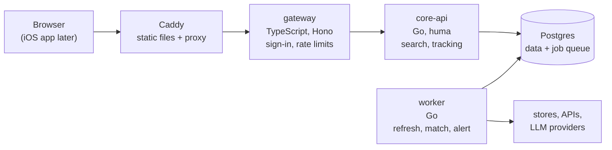

# Dipwatch

Name a product, see who sells it cheapest, and get alerted when the price dips.

Dipwatch collects offers for a product (for example "RTX 5090") from stores in China and overseas, filters out accessories and unrelated listings with an LLM, ranks what is left by price, and tracks the product for you. When a tracked product drops in price or comes back in stock, it sends you an email or a Feishu message.

It is also a learning project: a Go backend, an AI browsing agent, and a full CI/CD pipeline, built in one week with spec-driven development. See [docs/](docs/) for the spec, design and daily tasks.

> **Status: Day 3 of 7.** The worker fetches offers from Kakaku.com, and an AI agent reads Amazon US, Amazon Japan and SMZDM in a real browser. Search and alerts are not built yet. Progress is tracked in [docs/tasks.md](docs/tasks.md).

## Features

| Feature                                                                                | Status                                                   |
| -------------------------------------------------------------------------------------- | -------------------------------------------------------- |
| Walking skeleton: web, gateway, core API, worker, Postgres, running with one command   | Done (Day 1)                                             |
| Typed API contract generated from Go, shared with the web client                       | Done (Day 1)                                             |
| CI: lint, tests against real Postgres, contract drift check, secret scan, image builds | Done (Day 1)                                             |
| Source feasibility study for 13 stores                                                 | Done (Day 1), see [results](docs/spikes/day1-sources.md) |
| Search across sources, ranked by price, with currency selector (default CNY)           | Planned (Days 2 to 5)                                    |
| AI browsing agent for stores without an API (Amazon US, Amazon Japan, SMZDM)           | Done (Day 3)                                             |
| Agent harness: budgets, guards, run recording with cost and trace                      | Done (Day 3)                                             |
| Agent offline eval set: precision, recall and cost per store                           | Planned (Day 4)                                          |
| Admin run viewer and per-source agent metrics                                          | Planned (Day 5)                                          |
| LLM matching: drop accessories, extract specs, English titles                          | Planned (Day 4)                                          |
| Sign in with email or GitHub                                                           | Planned (Day 5)                                          |
| Track products with notes and alert rules, price history chart                         | Planned (Day 6)                                          |
| Email alerts (Feishu after week 1)                                                     | Planned (Day 6)                                          |
| Daily LLM spend limit, per-user quotas, prompt-injection test                          | Planned (Days 4 to 7)                                    |
| Full database schema, typed queries (sqlc), job queue (River)                          | Done (Day 2)                                             |
| Background refresh job: fetch offers, keep price history                               | Done (Day 2)                                             |
| First live source: Kakaku.com (Japan)                                                  | Done (Day 2)                                             |
| Deploy on merge to `main`, with automatic rollback                                     | Written (Day 2), waiting for server access               |
| iOS app with push notifications                                                        | After week 1                                             |

## How it works



- **Caddy** serves the built web app and forwards `/api` and `/auth` to the gateway. It is the only service reachable from outside.
- **gateway** handles sign-in and sessions, then calls core with the member's id and a shared internal token. It strips any identity headers a client sends.
- **core-api** owns all product data and generates the OpenAPI contract that every client uses.
- **worker** runs background jobs: refreshing offers, matching listings with an LLM, checking alert rules and sending notifications.
- **Sources** are tried cheapest first: official API, a store's MCP server, a plain HTML parser, and finally an AI agent driving a real browser. Scheduled price checks reuse what the agent learned, so they cost no LLM tokens. Details in [docs/design.md](docs/design.md).

## Repository layout

```
contracts/openapi.yaml   API contract, generated from the Go code (do not edit)
core/                    Go module: core API and worker
  cmd/core-api/          HTTP server; subcommands serve, migrate, openapi
  cmd/worker/            background job runner
  internal/config/       environment variables
  internal/db/           Postgres pool and embedded SQL migrations
  internal/http/         API operations (source of the contract)
  internal/jobs/         River jobs, e.g. refresh a product
  internal/money/        prices as integer minor units
  internal/sources/      source adapters and the strategy registry
  internal/store/        typed queries generated by sqlc
gateway/                 TypeScript gateway (Hono)
web/                     React web app (Vite, TanStack Query, Tailwind)
  src/api/               typed client generated from the contract
deploy/                  docker compose file, Caddyfile, .env.example
tools/spike/             one-off feasibility programs
docs/                    constitution, spec, design, daily tasks, spike results
.github/workflows/       CI
```

## Tech stack

| Layer   | Choice                                                                                 |
| ------- | -------------------------------------------------------------------------------------- |
| Web     | React 19, Vite, TanStack Query, Tailwind CSS, `openapi-fetch`                          |
| Gateway | TypeScript, Node 24, Hono (Better Auth from Day 5)                                     |
| Core    | Go 1.27, huma + chi, pgx, goose, sqlc, River, goquery                                  |
| Agent   | Go MCP client driving Playwright MCP, any OpenAI-compatible LLM (DeepSeek, Qwen, Kimi) |
| Data    | Postgres 16                                                                            |
| Edge    | Caddy                                                                                  |
| CI/CD   | GitHub Actions, images in Aliyun Container Registry, deploy over SSH                   |

## Run it locally

Requirements: Go 1.27, Node 24, pnpm, Docker, and `make`.

```bash
git clone https://github.com/FinA1ee/dipwatch.git
cd dipwatch
pnpm install
make dev
```

`make dev` creates `deploy/.env` with random secrets on first run, builds the images and starts the stack. Open http://localhost:18080. The status card should show "core: ok" and "db: ok".

Default host ports are 18080 (site) and 25432 (Postgres, localhost only), chosen to avoid clashing with other local services. Change `HTTP_PORT` and `PG_HOST_PORT` in `deploy/.env` if needed.

### Common commands

| Command                                        | What it does                                                                |
| ---------------------------------------------- | --------------------------------------------------------------------------- |
| `make dev`                                     | Build and start everything                                                  |
| `make down`                                    | Stop everything (data is kept)                                              |
| `make logs`                                    | Follow logs                                                                 |
| `make db`                                      | Start only Postgres, for running Go tests on the host                       |
| `make test`                                    | Go and TypeScript tests                                                     |
| `make lint`                                    | `go vet`, Biome, TypeScript type-check                                      |
| `make contract`                                | Regenerate the API contract and web client types after changing Go handlers |
| `make spike`                                   | Re-run the source feasibility check                                         |
| `make source-smoke SOURCE=kakaku Q="RTX 5090"` | Search one live source and print the offers                                 |
| `make refresh Q="RTX 5090"`                    | Ask the running worker to refresh a product                                 |
| `make sqlc`                                    | Regenerate typed queries after changing SQL                                 |

## Documentation

- [Constitution](docs/constitution.md): principles and hard constraints
- [Spec](docs/spec.md): requirements and success metrics
- [Design](docs/design.md): architecture, data model, agent, deployment
- [Tasks](docs/tasks.md): the 7-day plan with daily success metrics
- [Agent harness log](docs/harness.md): every prompt and harness change with its results
- [Day 1 source spike](docs/spikes/day1-sources.md)

## A note on data collection

Dipwatch reads public listing pages at low volume for personal price tracking. It sends one request at a time per site and does not try to get past blocks or logins. Check a site's terms before enabling it as a source.

## License

[MIT](LICENSE)
