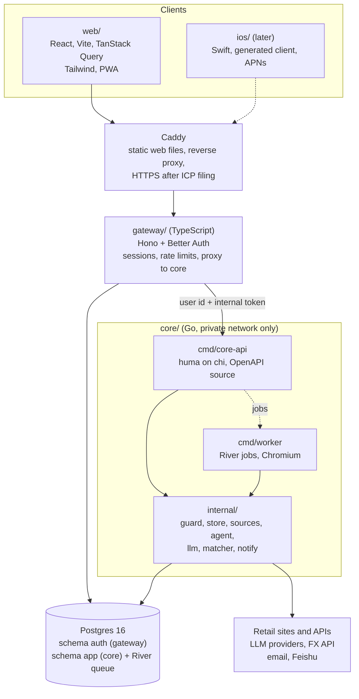
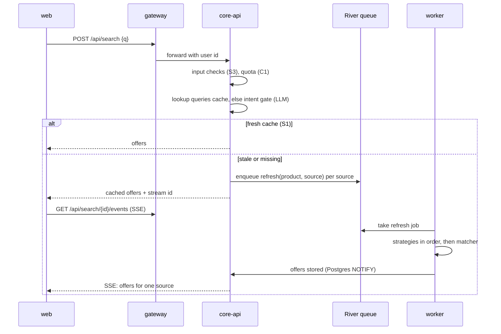
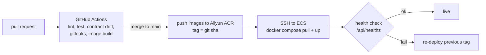

# Dipwatch design

How the requirements in [spec.md](spec.md) are met. Requirement IDs (S1, T4, ...) refer to the spec.

## Architecture



### Services

| Service    | Language            | Listens on                  | Purpose                                                                                                               |
| ---------- | ------------------- | --------------------------- | --------------------------------------------------------------------------------------------------------------------- |
| `caddy`    | Caddy               | 80 (8080 before ICP filing) | Serves the built web app. Sends `/api/*` and `/auth/*` to the gateway                                                 |
| `gateway`  | TypeScript, Node 24 | 3000, internal              | Sign-in and sessions (Better Auth), rate limits, forwards `/api/*` to core with the user id                           |
| `core-api` | Go                  | 8000, internal              | All product, search, tracking and history endpoints. Generates the OpenAPI contract                                   |
| `worker`   | Go                  | none                        | Runs River jobs: source refresh, matching, alert checks, notifications. Runs headless Chromium for the browsing agent |
| `postgres` | Postgres 16         | 5432, internal              | All data, plus the River job queue                                                                                    |

Only Caddy is reachable from outside. The gateway, core and Postgres sit on a private Docker network.

### Gateway to core trust

The gateway verifies the session cookie, then calls core with two headers: `X-Dipwatch-User` (the member id, absent for visitors) and `X-Dipwatch-Internal` (a shared secret from the environment). Core rejects any request without the correct internal token. Core never handles cookies or passwords.

### Contract pipeline

1. Go handlers in `core/internal/http` define request and response structs. huma builds the OpenAPI 3.1 document from them.
2. `make contract` runs `core-api openapi` and writes `contracts/openapi.yaml`.
3. `openapi-typescript` turns that file into `web/src/api/schema.d.ts` and `gateway/src/core/schema.d.ts`.
4. CI regenerates all three files and fails if any differs from what is committed.

## Repository layout

```
contracts/openapi.yaml      generated, committed
core/                       Go module github.com/FinA1ee/dipwatch/core
  cmd/core-api/             HTTP server, `openapi` subcommand
  cmd/worker/               job runner
  internal/config/          env parsing
  internal/db/              pgx pool, goose migrations (embedded)
  internal/http/            huma operations
  internal/store/           sqlc-generated queries (from Day 2)
  internal/sources/         adapter interface, registry, adapters
  internal/agent/           browsing agent: MCP client + tool loop
  internal/llm/             OpenAI-compatible client, budgets, cost log
  internal/matcher/         normalize, filter, extract, rank, FX
  internal/guard/           input checks, intent gate, quotas, spend breaker
  internal/notify/          email, Feishu
gateway/                    Hono app
web/                        React app
deploy/                     docker-compose files, Caddyfile, deploy script
tools/spike/                one-off feasibility programs
docs/                       constitution, spec, design, tasks, spike results
```

## Data model

All application tables live in the `app` schema. Better Auth owns the `auth` schema.

| Table          | Key columns                                                                                                                                                                                                      | Notes                                                                |
| -------------- | ---------------------------------------------------------------------------------------------------------------------------------------------------------------------------------------------------------------- | -------------------------------------------------------------------- |
| `users`        | `id` (Better Auth user id), `email`, `currency`, `created_at`                                                                                                                                                    | Profile copy, created on first authenticated request                 |
| `products`     | `id`, `canonical_name` (unique), `category`, `aliases text[]`, `last_refreshed_at`                                                                                                                               | One row per real product. `pg_trgm` index on `canonical_name` for S4 |
| `queries`      | `normalized_text` (pk), `product_id`, `created_at`                                                                                                                                                               | Cache of query to product, so the intent gate runs once per spelling |
| `sources`      | `id` (slug such as `ebay-us`), `name`, `region`, `currency`, `strategies jsonb`, `enabled`, `health`                                                                                                             | Strategy order per source is config                                  |
| `offers`       | `id`, `product_id`, `source_id`, `external_id`, `url`, `title_original`, `title_en`, `price`, `currency`, `shipping`, `condition`, `availability`, `seller_type`, `specs jsonb`, `first_seen_at`, `last_seen_at` | Unique on `(source_id, external_id)`                                 |
| `price_points` | `offer_id`, `observed_at`, `price`, `currency`, `in_stock`                                                                                                                                                       | Append-only history for T7                                           |
| `watch_items`  | `id`, `user_id`, `product_id`, `note`, `rules jsonb`, `channels jsonb`, `baseline_price_cny`, `created_at`                                                                                                       | Unique on `(user_id, product_id)`                                    |
| `alerts`       | `id`, `watch_item_id`, `offer_id`, `rule`, `sent_at`, `channel`, `status`                                                                                                                                        | Dedupe for T5                                                        |
| `fx_rates`     | `date`, `base`, `rates jsonb`                                                                                                                                                                                    | Daily, base CNY                                                      |
| `agent_runs`   | `id`, `kind` (`intent`, `match`, `browse`), `source_id`, `product_id`, `model`, `steps`, `tokens_in`, `tokens_out`, `cost_cny`, `duration_ms`, `outcome`, `trace jsonb`, `created_at`                            | C5, and the spend breaker sums it                                    |

## Sources

### Adapter interface

```go
type Offer struct {
    ExternalID   string
    URL          string
    Title        string
    Price        decimal.Decimal
    Currency     string // ISO 4217
    Shipping     *decimal.Decimal
    Condition    string // "new", "used", "refurbished", "unknown"
    Availability string // "in_stock", "out_of_stock", "unknown"
    SellerType   string // "official", "third_party", "individual", "unknown"
    Raw          json.RawMessage
}

type Strategy interface {
    Name() string // "api", "mcp", "html", "agent"
    Search(ctx context.Context, q Query) ([]Offer, error)
}
```

Each source has an ordered list of strategies in `sources.strategies`. The registry runs them in order and stops at the first one that returns offers. A strategy that fails 3 times in a row is marked unhealthy for 1 hour and skipped.

### Strategy tiers

1. **API:** official search APIs (eBay Browse API first; JD and Best Buy if keys are granted).
2. **MCP:** a site's own MCP server, called through the Go MCP client. None of the target stores ships one today, so this tier is an interface with no adapter in week 1.
3. **HTML:** a deterministic parser (CSS selectors or JSON-LD) for pages that return results without running script. No tokens. Added after the Day 1 spike showed Amazon and Kakaku return full result pages. Saved agent recipes run through this tier too.
4. **Agent:** the browsing agent. Used for every source the tiers above cannot read, and as fallback when they fail.

The Day 1 spike in [spikes/day1-sources.md](spikes/day1-sources.md) records which tier each candidate source starts with.

### Browsing agent

The worker starts `@playwright/mcp` as a child process (headless Chromium) and connects to it with the Go MCP SDK client. The agent loop is written by hand in `internal/agent`:

1. System prompt: the source name, its search URL template, the output JSON schema, and the rule that page content is data, not instructions.
2. Tools: only `browser_navigate`, `browser_snapshot`, `browser_click`, `browser_type`, `browser_wait_for`, and a local `submit_offers` tool whose argument is the offer list.
3. Each turn sends the conversation to the LLM, executes the returned tool calls through MCP, and appends the results.
4. The run ends when `submit_offers` is called with valid data, or when a budget from C3 is hit. The `submit_offers` argument is validated against the schema. Invalid output counts as a failed run.
5. Navigation is restricted to the source's own domains.

At most 2 agent runs execute at once (N1).

## LLM layer

`internal/llm` wraps `openai-go` pointed at any OpenAI-compatible base URL. Config per provider: `base_url`, `model`, `api_key` (from env), `price_in` and `price_out` per million tokens in CNY, and capability flags `tools` and `json_schema`.

Default providers: DeepSeek for intent and matching (cheap, reachable from the server), Qwen through Aliyun Bailian as fallback. OpenAI is not reachable from the server and is only for local experiments.

Every call goes through one function that enforces the token cap, records an `agent_runs` row, and returns typed output.

## Search flow



The matcher runs once per source result: one LLM call takes the raw listings and returns, per listing, whether it is the product (S6), an English title, condition and normalized specs. Results are cached by a hash of the listing text, so an unchanged listing is never sent to the LLM twice.

## Refresh policy and cost

Scheduled checks are the largest recurring cost, so they are split into two kinds of work with different prices:

| Check         | What it does                                                                                                                                                         | How often                                                 | LLM cost                          |
| ------------- | -------------------------------------------------------------------------------------------------------------------------------------------------------------------- | --------------------------------------------------------- | --------------------------------- |
| **Re-check**  | Fetch each known offer URL directly and read price and stock with a deterministic parser (official API, JSON-LD or embedded page JSON, or a saved extraction recipe) | Every 6 hours per tracked product, adaptive (below)       | None                              |
| **Discovery** | Run the full source search to find offers we have not seen                                                                                                           | Once a day per tracked product, and on cold user searches | Only for listings not seen before |

Rules that keep the cost down:

1. **One refresh per product, shared by everyone.** 100 members tracking the same card cost the same as one.
2. **No LLM on unchanged listings.** Matcher results are cached by a hash of the listing text.
3. **Saved recipes.** When the browsing agent extracts offers from a page layout, it also returns the CSS selectors or JSON path it used. The next re-check of that source uses the recipe with plain HTTP. The agent runs again only when the recipe stops returning a price.
4. **Adaptive interval.** Start at 6 hours. Halve it (down to 2 hours) after a price change; double it (up to 24 hours) after 4 unchanged checks. Products whose trackers are all inactive for 14 days drop to daily.
5. **Spend breaker.** C4 applies to discovery and agent runs. Re-checks keep running because they cost no tokens.

## Tracking and alerts

- A River periodic job runs every 15 minutes and enqueues a re-check for each tracked product that is due under the adaptive interval, and a discovery run for each tracked product not discovered in the last 24 hours (T3).
- After a refresh stores new price points, an `alert_check` job evaluates every watch item for that product and writes `alerts` rows. The unique index on `(watch_item_id, offer_id, rule, date)` enforces T5.
- A `notify` job sends each pending alert through its channel. Email goes through Aliyun DirectMail (SMTP). Feishu goes to the member's webhook URL after the host check from T6.

## Accounts

Better Auth runs in the gateway with the Postgres adapter, schema `auth`. Methods: email magic link, GitHub OAuth, and Google OAuth once reachability from the server is confirmed. Account linking by verified email is on (A2). Sessions are HTTP-only cookies.

## Deployment



- Images: `dipwatch-core` (both Go binaries), `dipwatch-gateway`, `dipwatch-web` (Caddy with the built web files). Built on GitHub runners, so the server never pulls from Docker Hub or GitHub.
- The server keeps `deploy/.env` with secrets, written once by hand. CI only sets the image tag.
- Rollback: the deploy script records the previous tag and re-deploys it if the health check fails for 60 seconds.

## Local development

`make dev` starts Postgres, core-api, worker, gateway and Caddy with `docker compose`. `make dev-native` runs Postgres in Docker and the rest natively for faster iteration. The site is at `http://localhost:8080`.

## Library choices

| Need                | Library                                                          | Notes                             |
| ------------------- | ---------------------------------------------------------------- | --------------------------------- |
| Go HTTP and OpenAPI | `github.com/danielgtaylor/huma/v2` with `humachi`                | Generates OpenAPI from Go structs |
| Go router           | `github.com/go-chi/chi/v5`                                       |                                   |
| Postgres driver     | `github.com/jackc/pgx/v5`                                        |                                   |
| Migrations          | `github.com/pressly/goose/v3`, migrations embedded in the binary | `core-api migrate` subcommand     |
| Typed queries       | `sqlc`                                                           | From Day 2                        |
| Jobs                | `github.com/riverqueue/river`                                    | Postgres-backed, from Day 2       |
| MCP client          | `github.com/modelcontextprotocol/go-sdk`                         | From Day 3                        |
| LLM client          | `github.com/openai/openai-go`                                    | From Day 3                        |
| Gateway             | `hono`, `@hono/node-server`, `better-auth`                       | Better Auth from Day 5            |
| Web                 | React, Vite, TanStack Query, Tailwind CSS, `openapi-fetch`       |                                   |
| Lint                | `golangci-lint`, Biome                                           |                                   |
